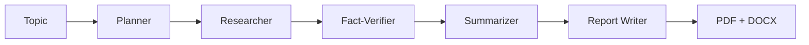

# 🤖 Multi-Agent AI Research & Automated Report Generation Platform

> An autonomous multi-agent system that researches the web on any topic, verifies the facts, and delivers a publication-ready **PDF** and **DOCX** report with a table of contents and citations.


---

## 📌 Overview

You enter a topic such as *"Future of electric vehicles in India"*. A team of specialized AI agents, orchestrated with **LangGraph**, plans the research, searches the web, cross-checks the facts, summarizes the findings and writes a structured report. The result is available in the UI and as downloadable PDF and DOCX files.

## ✨ Features

- **Autonomous multi-agent workflow** with five specialized agents coordinated by a LangGraph state graph
- **Live web research** using the Tavily Search API with parallel queries
- **Fact verification** that keeps only claims backed by sources and assigns a confidence level (high / medium)
- **Citation tracking** with numbered `[n]` references and a full source list in every report
- **Automated document synthesis** into PDF (ReportLab) and DOCX (python-docx) with title page, table of contents and references
- **Async REST API** built on FastAPI with Pydantic validation, background jobs, global error handling and structured JSON logging
- **Persistent job history** in MongoDB, with automatic in-memory fallback for local development
- **Streamlit UI** with live progress, report preview, fact-check results and one-click downloads

## 🧠 How It Works



| Agent | Responsibility |
|---|---|
| **Planner** | Breaks the topic into focused research questions |
| **Researcher** | Runs web searches (Tavily) for every question in parallel and collects deduplicated sources |
| **Fact-Verifier** | Extracts key claims, checks them against the sources and drops unsupported or low-confidence ones |
| **Summarizer** | Condenses the verified facts into a concise brief |
| **Report Writer** | Produces a structured report with sections, conclusion and `[n]` citations |

## 🛠️ Tech Stack

| Layer | Technology |
|---|---|
| Language | Python |
| Agent orchestration | LangGraph |
| LLM | Google Gemini API |
| Web search | Tavily API |
| Backend | FastAPI, Pydantic, Uvicorn |
| Database | MongoDB (Motor, async driver) |
| Frontend | Streamlit |
| Documents | ReportLab (PDF), python-docx (DOCX) |

## 📁 Project Structure

```
ai-research-platform/
├── backend/
│   ├── app/
│   │   ├── agents/
│   │   │   ├── graph.py        # LangGraph pipeline and all agents
│   │   │   └── llm.py          # Gemini client and JSON helpers
│   │   ├── services/
│   │   │   ├── report.py       # PDF and DOCX generation
│   │   │   └── runner.py       # Background job runner
│   │   ├── config.py           # Settings and JSON logging
│   │   ├── db.py               # MongoDB store with in-memory fallback
│   │   ├── main.py             # FastAPI app and endpoints
│   │   └── models.py           # Pydantic schemas
│   └── outputs/                # Generated reports
├── frontend/
│   └── app.py                  # Streamlit UI
├── .env.example
├── requirements.txt
└── README.md
```

## 🚀 Getting Started

### Prerequisites

- Python 3.11 or 3.12
- [Gemini API key](https://aistudio.google.com/apikey)
- [Tavily API key](https://tavily.com)
- MongoDB Atlas URI or a local MongoDB (optional, falls back to in-memory storage)

### 1. Clone the repository

```bash
git clone https://github.com/mithxcode/ai-research-platform.git
cd ai-research-platform
```

### 2. Create a virtual environment and install dependencies

```bash
python -m venv venv

# Windows
venv\Scripts\activate
# macOS / Linux
source venv/bin/activate

pip install -r requirements.txt
```

### 3. Configure environment variables

```bash
# Windows: copy .env.example .env
cp .env.example .env
```

Edit `.env`:

```env
GEMINI_API_KEY=your_gemini_key
GEMINI_MODEL=gemini-3.8-flash
TAVILY_API_KEY=your_tavily_key
MONGO_URI=mongodb+srv://<user>:<password>@<cluster>.mongodb.net/
MONGO_DB=research_platform
BACKEND_URL=http://localhost:8000
```

> Gemini model names change over time. If you get a `404 model not found` error, set `GEMINI_MODEL` to a currently available Flash model from [Google AI Studio](https://aistudio.google.com).

### 4. Run the application

**Terminal 1: Backend**

```bash
cd backend
uvicorn app.main:app --reload
```

**Terminal 2: Frontend** (from the project root)

```bash
streamlit run frontend/app.py
```

- UI: http://localhost:8501
- API docs (Swagger): http://localhost:8000/docs

## 🔌 API Endpoints

| Method | Endpoint | Description |
|---|---|---|
| `GET` | `/health` | Health check |
| `POST` | `/research` | Start a research job (`topic`, `depth`), returns `job_id` |
| `GET` | `/research/{job_id}` | Job status, progress and final report |
| `GET` | `/research/{job_id}/download/{pdf\|docx}` | Download the generated report |
| `GET` | `/jobs` | Recent research history |

Example:

```bash
curl -X POST http://localhost:8000/research \
  -H "Content-Type: application/json" \
  -d '{"topic": "Agentic AI in software engineering", "depth": 4}'
```

## 🔮 Future Improvements

- Streaming agent progress with WebSockets
- Support for uploading private documents (RAG)
- Multiple report templates and export formats
- User authentication and per-user history
- Docker setup for one-command deployment

## 👤 About the Author

**Mithilesh Kumar | AI Engineer & Backend Systems Developer**

I build autonomous AI applications, agentic workflows, scalable backend systems and high-performance RAG pipelines. This project shows how I approach multi-agent orchestration, grounded answers, structured outputs and source citations, not just a chat demo. [PolicyGPT](https://github.com/mithxcode) is another project of mine in this space.

I am a Computer Science & Engineering student at Chandigarh Engineering College (CEC), CGC Landran, Mohali (B.Tech, 2023 to 2027), originally from Banka, Bihar, India.

### What I work on

- Multi-agent systems and agentic workflows
- Retrieval-Augmented Generation (RAG) pipelines
- Backend APIs and scalable AI services

**Tech I use:** Python · FastAPI · LangGraph · LangChain · OpenAI · Google Gemini · Pinecone · Streamlit

### Find me online

| Platform | Link |
|---|---|
| 🌐 Portfolio | [mithilesh-kumar-ai-engineer.netlify.app](https://mithilesh-kumar-ai-engineer.netlify.app) |
| 💼 LinkedIn | [linkedin.com/in/mithileshkumar001](https://linkedin.com/in/mithileshkumar001) |
| 💻 GitHub | [github.com/mithxcode](https://github.com/mithxcode) |
| ✍️ DEV Community | [dev.to/mithxcode](https://dev.to/mithxcode) |
| 🐦 X (Twitter) | [x.com/MITHILESH_7781](https://x.com/MITHILESH_7781) |

Looking for **AI Engineer** or **Backend Developer** opportunities and open-source collaborations. Feel free to connect.

---

**Keywords:** Mithilesh Kumar, AI Engineer, Backend Developer, RAG, Multi-Agent Systems, LangGraph, FastAPI, Python
